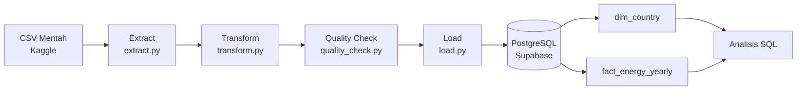

# Energy ETL Pipeline

Pipeline ETL (Extract-Transform-Load) yang memproses data energi berkelanjutan
176 negara (2000-2020), membersihkan masalah kualitas data, dan memuatnya ke
database relasional PostgreSQL untuk dianalisis dengan SQL.

## Arsitektur

## Tech Stack

- Python (pandas, SQLAlchemy, psycopg2)
- PostgreSQL (Supabase)
- SQL

## Struktur Database

- `dim_country`: data statis per negara (density, land area, lat/long)
- `fact_energy_yearly`: data tahunan per negara (176 negara x 21 tahun)

## Temuan Data Quality

- Kolom `Density` awalnya kebaca sebagai teks karena format koma ribuan (contoh: "2,239"), diperbaiki di tahap transform
- Beberapa kolom punya missing value signifikan, contoh `renewables_pct_equivalent_primary_energy` kosong 58.56%, kemungkinan karena data belum lengkap dilaporkan semua negara
- Ditemukan 1 nilai persentase di luar rentang wajar (Bhutan, 2005: 100.00001%), dikoreksi jadi maksimal 100 (pembulatan floating-point)
- Data tahun 2020 untuk kolom `renewable_energy_share_pct` baru terisi 1 dari 176 negara, karena jeda pelaporan data dari sumber resmi. Analisis "tahun terbaru" memakai 2019 sebagai gantinya

## Cara Menjalankan

1. Install dependencies: `pip install -r requirements.txt`
2. Buat file `.env` berisi `DATABASE_URL` (connection string PostgreSQL kamu)
3. Jalankan: `python pipeline.py`

## Insight dari Analisis SQL

Lihat `sql/analysis_queries.sql` untuk query lengkapnya. Salah satu temuan:
negara dengan kenaikan porsi energi terbarukan terbesar dari 2000 ke 2019.
